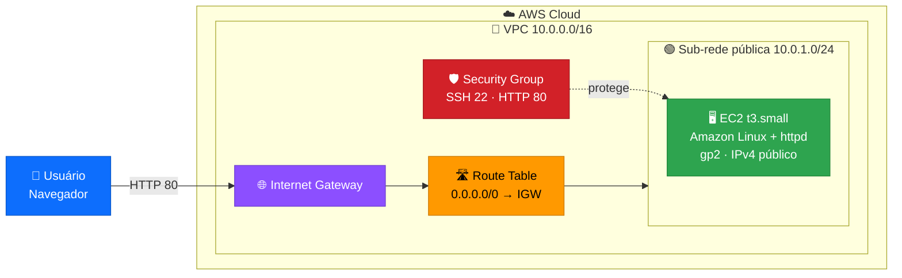
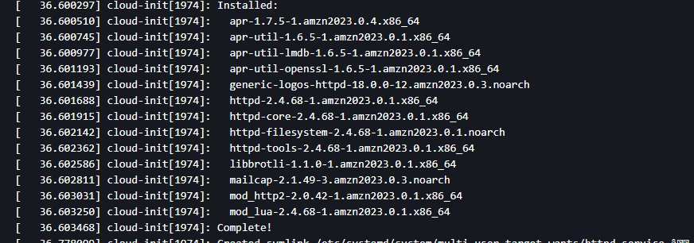
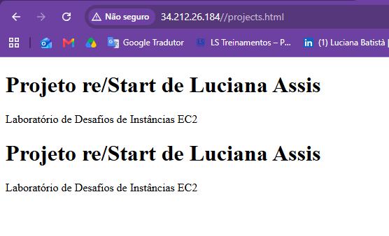

<div align="center">


**Projeto prático do programa AWS re/Start: do zero à página web no ar** ☁️🚀

</div>

---

## 📌 Sobre o projeto

Neste laboratório, criei uma **infraestrutura de rede do zero** na AWS e coloquei um **servidor web Apache (httpd)** no ar em uma instância **Amazon EC2**, utilizando apenas o **Console de Gerenciamento da AWS**.

O projeto cobre desde a criação da rede (VPC, sub-rede, gateway de internet e rotas) até a automação da instalação do servidor por **User Data** e a publicação de uma página HTML acessível pela internet.

---

## 🎯 Objetivos

- ✅ Criar uma **VPC** e uma **sub-rede pública** novas
- ✅ Configurar **Internet Gateway** e **tabela de rotas**
- ✅ Lançar uma instância **EC2 Amazon Linux** do tipo **T3** (menor que medium)
- ✅ Atribuir automaticamente um **IPv4 público**
- ✅ Instalar e iniciar o **httpd** via **User Data**
- ✅ Usar volume **SSD de uso geral (gp2)** como volume raiz
- ✅ Configurar **Security Group** liberando **SSH (22)** e **HTTP (80)**
- ✅ Conectar à instância via **EC2 Instance Connect**
- ✅ Publicar a página `projects.html` e validar no navegador

---

## 🗺️ Arquitetura



---

## 🧰 Tecnologias e serviços

| 🎨 Categoria | 🔧 Tecnologia | 📝 Função no projeto |
|:---:|:---:|---|
| ☁️ Cloud | **Amazon EC2** | Servidor virtual que hospeda o site |
| 🌐 Rede | **Amazon VPC** | Rede privada isolada e sub-rede pública |
| 🚪 Rede | **Internet Gateway** | Conecta a VPC à internet |
| 🛣️ Rede | **Route Table** | Direciona o tráfego externo para o gateway |
| 🛡️ Segurança | **Security Group** | Libera apenas SSH (22) e HTTP (80) |
| 💾 Storage | **EBS gp2** | Volume raiz SSD de uso geral |
| 🐧 SO | **Amazon Linux** | Sistema operacional da instância |
| 🕸️ Web | **Apache httpd** | Servidor web |
| 🔑 Acesso | **EC2 Instance Connect** | SSH direto pelo navegador |

---

## ⚙️ Configuração utilizada

| 🔹 Recurso | 🔸 Valor |
|---|---|
| **VPC** | `lab-vpc` · `10.0.0.0/16` |
| **Sub-rede** | `lab-subnet-publica` · `10.0.1.0/24` |
| **Internet Gateway** | `lab-igw` (anexado à VPC) |
| **Rota** | `0.0.0.0/0` → `lab-igw` |
| **Security Group** | `lab-sg-web` (TCP 22 e TCP 80) |
| **AMI** | Amazon Linux |
| **Tipo de instância** | `t3.small` |
| **Volume raiz** | `gp2` · 8 GiB |
| **IP público** | Atribuição automática habilitada |

---

## 🧾 User Data (automação)

Script executado automaticamente na inicialização da instância:

```bash
#!/bin/bash
yum update -y
yum install -y httpd
systemctl enable httpd
systemctl start httpd
usermod -a -G apache ec2-user
chown -R ec2-user:apache /var/www/html
chmod 2775 /var/www/html
find /var/www/html -type d -exec chmod 2775 {} \;
find /var/www/html -type f -exec chmod 0664 {} \;
```

> 💡 O script instala e inicia o Apache, habilita o serviço na inicialização do sistema e concede permissão de escrita em `/var/www/html`.

---

## 🪜 Passo a passo resumido

### 🔷 1. Rede
1. Criar a VPC `10.0.0.0/16` e habilitar nomes de host DNS
2. Criar a sub-rede pública `10.0.1.0/24`
3. Habilitar a atribuição automática de IPv4 público na sub-rede
4. Criar o Internet Gateway e anexá-lo à VPC
5. Criar a tabela de rotas, adicionar `0.0.0.0/0 → IGW` e associá-la à sub-rede

### 🛡️ 2. Segurança
6. Criar o Security Group com entrada **SSH (22)** e **HTTP (80)**

### 🖥️ 3. Instância
7. Lançar a EC2 com AMI Amazon Linux, `t3.small` e volume `gp2`
8. Selecionar a VPC, a sub-rede e o Security Group criados
9. Colar o script de **User Data** em *Detalhes avançados*

### 🌐 4. Publicação e teste
10. Conectar via **EC2 Instance Connect**
11. Criar o arquivo `projects.html` e copiá-lo para `/var/www/html`
12. Acessar `http://<IP-PUBLICO>/projects.html` no navegador

---

## 📄 Página publicada

```html
<!DOCTYPE html>
<html>
<body>
<h1>SEU-NOME's re/Start Project Work</h1>
<p>EC2 Instance Challenge Lab</p>
</body>
</html>
```

```bash
sudo cp projects.html /var/www/html/
```

---

## 📸 Evidências

### 🟠 Log do sistema: httpd instalado com sucesso
<!-- Substitua pelo caminho da sua imagem -->


### 🟢 Página web funcionando no navegador
<!-- Substitua pelo caminho da sua imagem -->


---

## 🧠 Aprendizados

- 🌐 Como a **VPC**, a **sub-rede**, o **Internet Gateway** e a **tabela de rotas** trabalham juntos para dar acesso à internet
- 🛡️ A função do **Security Group** como firewall da instância
- 🤖 Como automatizar a configuração de um servidor com **User Data**
- 🔑 Como acessar uma instância com **EC2 Instance Connect**, sem precisar de cliente SSH local
- 🔐 Como ajustar **permissões de arquivos e diretórios** no Linux

---

## 🔮 Próximos passos

- [ ] Restringir o acesso SSH a um IP específico
- [ ] Habilitar **HTTPS** com certificado
- [ ] Adicionar um **Elastic IP** para manter o IP fixo
- [ ] Provisionar a mesma infraestrutura com **Terraform** ou **CloudFormation**
- [ ] Evoluir para um **Application Load Balancer** com Auto Scaling

---

## 💰 Observação sobre custos

> ⚠️ Ao finalizar o laboratório, **encerre a instância** para evitar cobranças desnecessárias.

---

<div align="center">

### 👩‍💻 Autora

**LUCIANA BATISTÀ**

[](https://www.linkedin.com/in/lucianarbassis/)
[](https://github.com/ALRA-CODE)

⭐ Se este projeto foi útil, deixe uma estrela no repositório!


</div>
